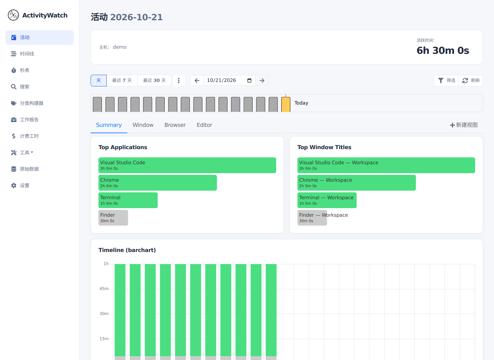
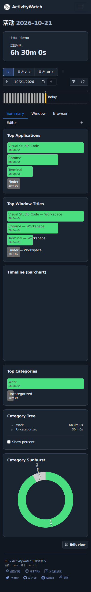

<h1 align="center">ActivityWatch</h1>
<p align="center"><strong>Workspace Edition</strong></p>
<p align="center">A clearer view of your time. A simpler daily review.</p>

<p align="center">
  <a href="README.md">简体中文</a> · <a href="README.en.md"><strong>English</strong></a>
</p>
<p align="center">
  <a href="https://github.com/TuSiV/activitywatch/actions/workflows/workspace-ui.yml"></a>
  <a href="LICENSE.txt"></a>
  <a href="https://github.com/ActivityWatch/activitywatch"></a>
</p>
<p align="center">
  <a href="#features">Features</a> · <a href="#get-started">Get started</a> · <a href="ui-overrides/README.md">Development</a> · <a href="https://docs.activitywatch.net/">Upstream docs</a>
</p>

A community-maintained fork of [ActivityWatch](https://github.com/ActivityWatch/activitywatch). It keeps automatic time tracking and local data storage, with a redesigned navigation, activity dashboard and work-report layout for everyday review.

<picture>
  <source media="(prefers-color-scheme: dark)" srcset=".github/images/workspace-dark.png">
  
</picture>
<p align="center"><sub>Actual rendering of the current code with synthetic demo data. The preview follows your GitHub light/dark theme. The captured interface is in Chinese.</sub></p>

## Features

| What you want to know | Where to go | What you can do |
| --- | --- | --- |
| Where the day went | Activity | Review active time, apps, window titles and categories by device and date |
| What happened at a particular time | Timeline | Browse events and filter by device, client, duration and category |
| How to organise your activity | Category Builder | Manage rules, category trees and colours |
| How much time went into work | Work Report | Select devices, categories and dates; review sessions; export CSV / JSON |
| How to time a task directly | Stopwatch | Start, stop and label a timed record |
| How to inspect or move records | Raw Data | Browse buckets and events, import and export activity data |

Browser tab titles and URLs require the corresponding browser extension. Other data sources are provided by separate watchers. See the [watcher documentation](https://docs.activitywatch.net/en/latest/watchers.html).

## A clearer workspace

- **Navigation in reach:** a persistent desktop sidebar and a drawer on smaller screens.
- **Readable activity cards:** prominent active time, separate ranking cards and a wide time-distribution chart.
- **Consistent themes:** shared text, border, surface and chart-axis colours, while preserving user category colours.
- **Lighter icons:** rounded outline glyphs with consistent sizing and alignment, plus brand and extension compatibility.
- **Reports at a glance:** total work time, session count and average duration above the daily breakdown.

<details>
<summary><strong>View the narrow-screen layout</strong></summary>
<br>
<p align="center"></p>

</details>

## Get started

**The customised interface is currently available by building from source. This repository has no public installer release yet.** Future downloads will be listed with their assets and notes under [this fork’s Releases](https://github.com/TuSiV/activitywatch/releases).

### Build the desktop suite

Follow the [upstream source-build guide](https://docs.activitywatch.net/en/latest/installing-from-source.html) to prepare Python, Poetry, Node.js, Make, Rust and platform dependencies, and activate a Python virtual environment. This fork’s frontend CI uses Node.js 22.

```sh
git clone --recurse-submodules --branch main https://github.com/TuSiV/activitywatch.git
cd activitywatch
make build
aw-qt
```

Open [localhost:5600](http://localhost:5600/) after startup. `aw-qt` manages the local server and default watchers. The [getting-started guide](https://docs.activitywatch.net/en/latest/getting-started.html) explains the first run.

<details>
<summary><strong>Build or develop the frontend only</strong></summary>

From a clone with initialized submodules:

```sh
python scripts/apply_webui_theme.py --webui aw-server/aw-webui
make -C aw-server/aw-webui build
```

Static output is written to `aw-server/aw-webui/dist/`. For development, run `make -C aw-server/aw-webui dev`. It connects to `127.0.0.1:5666` by default and requires a backend running in testing mode.

</details>

### First run

1. Confirm the local server, window watcher and AFK watcher are running.
2. Select a device, date or time range in Activity.
3. Adjust rules in Category Builder, then choose a language and theme in Settings.
4. Use Work Report to calculate and export a summary.

## Data and privacy

Activity records are stored by the local ActivityWatch server. They can contain application names, window titles, and titles or URLs captured by browser extensions. Enabled watchers determine the scope of collection. Review exports and screenshots before sharing them.

The outline icons are bundled locally with the code. Network activity from update checks, browser extensions and other components depends on their features and settings.

## Development and maintenance

The repository assembles upstream components through Git submodules. Custom frontend source lives in `ui-overrides/`. The root `make build` applies checksum-verified replacements; changed upstream files produce a path-specific error for review.

| Location | Purpose |
| --- | --- |
| [`ui-overrides/`](ui-overrides/README.md) | UI source, icons, styles and overlay maintenance |
| [`scripts/apply_webui_theme.py`](scripts/apply_webui_theme.py) | Validate and apply the custom frontend |
| [Workspace UI checks](https://github.com/TuSiV/activitywatch/actions/workflows/workspace-ui.yml) | Regression tests, locale checks and production build |
| [`CONTRIBUTING.md`](CONTRIBUTING.md) | Upstream contribution and development conventions |

Submit code improvements through [this repository’s Pull Requests](https://github.com/TuSiV/activitywatch/pulls). General usage questions can be discussed on the [ActivityWatch Forum](https://forum.activitywatch.net/).

## Credits and license

- Original project: [ActivityWatch](https://github.com/ActivityWatch/activitywatch), by Erik Bjäreholt, Johan Bjäreholt and community contributors.
- Fork maintenance and interface customisation: [YONGZHE CHEN · TuSiV](https://github.com/TuSiV).
- Project license: [MPL-2.0](LICENSE.txt). Lucide outline icons retain their [ISC notice](ui-overrides/static/licenses/lucide.txt). Submodules retain their original credits and licenses.
- For academic use, follow the [upstream citation information](https://github.com/ActivityWatch/activitywatch#how-to-cite-activitywatch) and [`CITATION.cff`](CITATION.cff).
