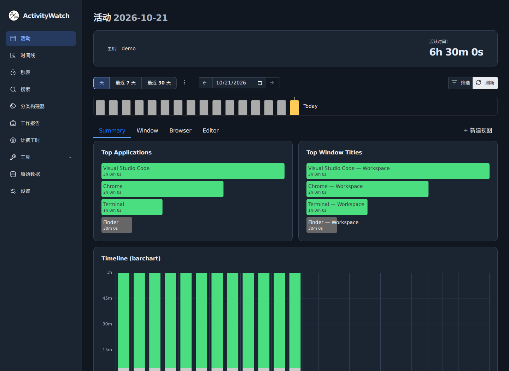

# Workspace UI

This fork adds a responsive time-analysis workspace to the pinned ActivityWatch frontend. Desktop navigation is a persistent sidebar; smaller windows use the existing modal drawer. Activity charts use separate cards, time-distribution charts span the available row, and work reports show total time, session count and average session before the daily table. Light/dark themes share semantic surface, border, text and accent tokens. Category colours, calculations, tracking, device selection, query filters, exports and experimental-feature gates remain driven by ActivityWatch's existing code.

## Source and builds

`ui-overrides/` contains reviewed frontend replacements plus a SHA-256 manifest. `scripts/apply_webui_theme.py` applies them to initialized Python/Rust/Tauri frontends before the root `make build`. `make screenshots` applies the same overlay. The upstream submodule URLs and commit pins remain unchanged; this fork does not push to upstream component repositories.

```sh
git clone --recurse-submodules https://github.com/TuSiV/activitywatch.git
cd activitywatch
python3 scripts/apply_webui_theme.py
make build
```

For frontend development only:

```sh
python3 scripts/apply_webui_theme.py --webui aw-server/aw-webui
make -C aw-server/aw-webui dev
```

For a standalone component build, apply the overlay explicitly before running that component's Makefile. The `--webui` option is repeatable. `--check` verifies application without changing files.

## Updating upstream

Every replaced file must match either its reviewed upstream hash or its already-applied replacement hash. CRLF checkouts are compared using canonical LF content, so Git for Windows does not invalidate reviewed text assets. All checkouts are validated before writing. Changed upstream files and local edits fail the build with the exact affected path rather than being overwritten. After a submodule update, rebase the affected replacements and regenerate their manifest hashes only after review. An existing initialized checkout can be reset using Git after preserving local changes; never regenerate hashes merely to silence a failure.

The Workspace UI workflow verifies overlay behavior, frontend regression tests, locale parity and a production build on `main`.

## Appearance

The captures below use synthetic API fixtures, not personal activity records.

| Desktop light | Desktop dark |
| --- | --- |
|  |  |

[Mobile activity view](../.github/images/workspace-mobile.png)

Validation includes both Vue CLI and Vite production builds, changed-source lint, six-locale key/placeholder parity, the existing frontend regression suite, overlay idempotence/drift checks, and a Chromium smoke test. The browser checks cover 1440px desktop and 390px phone layouts, date navigation, theme persistence, drawer navigation, time-report calculation, CSV download and timeline rendering. The browser uses deterministic API fixtures; installed Windows/macOS bundles are not exercised by this source change.

## Icons

Application icons use a curated local subset of Lucide 1.61.0 with rounded 1.75px strokes on a 24px grid, inspired by the compact line-icon treatment on OpenRouter. Existing icon names map to the new shapes, including device and native-action menus. Brands and extension-defined icons keep the compatible legacy renderer. SVGs inherit the surrounding text colour, preserve scale/labels/loading animations and respect reduced-motion preferences.

No runtime icon package or remote image requests are added. The Lucide ISC notice is bundled at `static/licenses/lucide.txt`.

## Desktop releases

Run **Actions → Workspace Release → Run workflow** on `main` with an unused `v0.14.x` tag. The workflow checks out pinned submodules, applies the workspace overlay, builds and tests standard Qt bundles for Windows x64, Linux x64, macOS Apple Silicon and macOS Intel, then validates the expected installers and creates `SHA256SUMS.txt`. The release and tag are created only after every platform succeeds; existing releases and tags are never overwritten.

This fork workflow produces installers without developer certificates and explicitly names macOS DMGs `unsigned`. It does not publish Tauri updater manifests or use upstream signing secrets. The upstream `Release` workflow remains separate. Release notes live in `.github/releases/workspace.md`; update them before each release, then update the bilingual README download link after publication.
